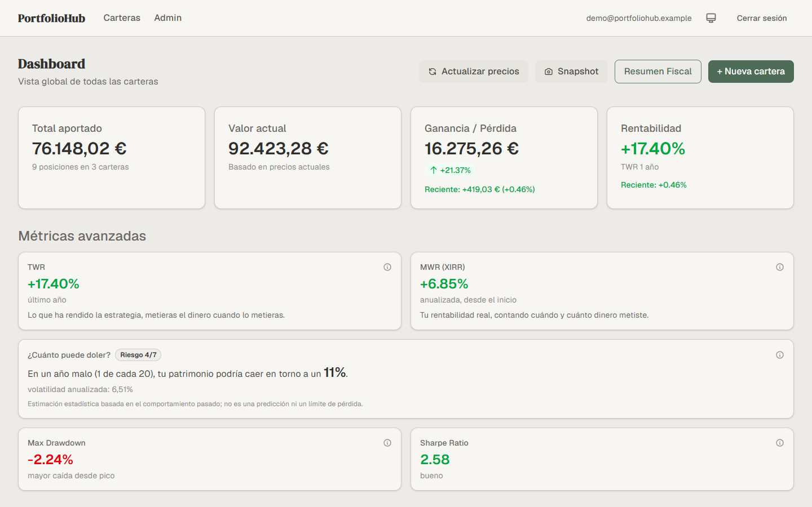
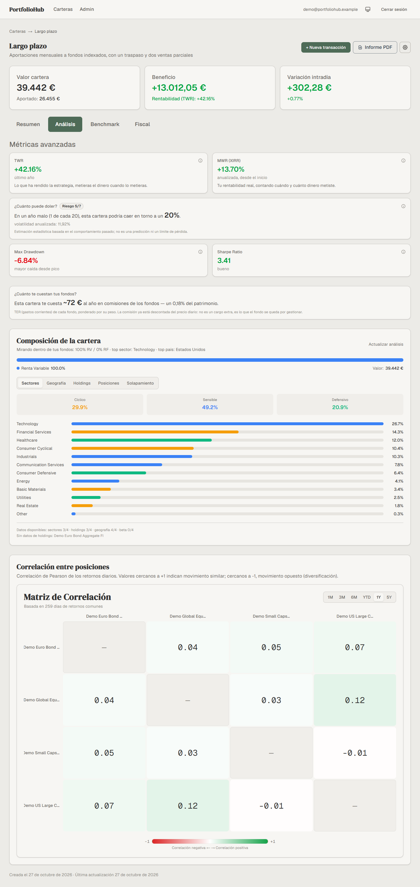
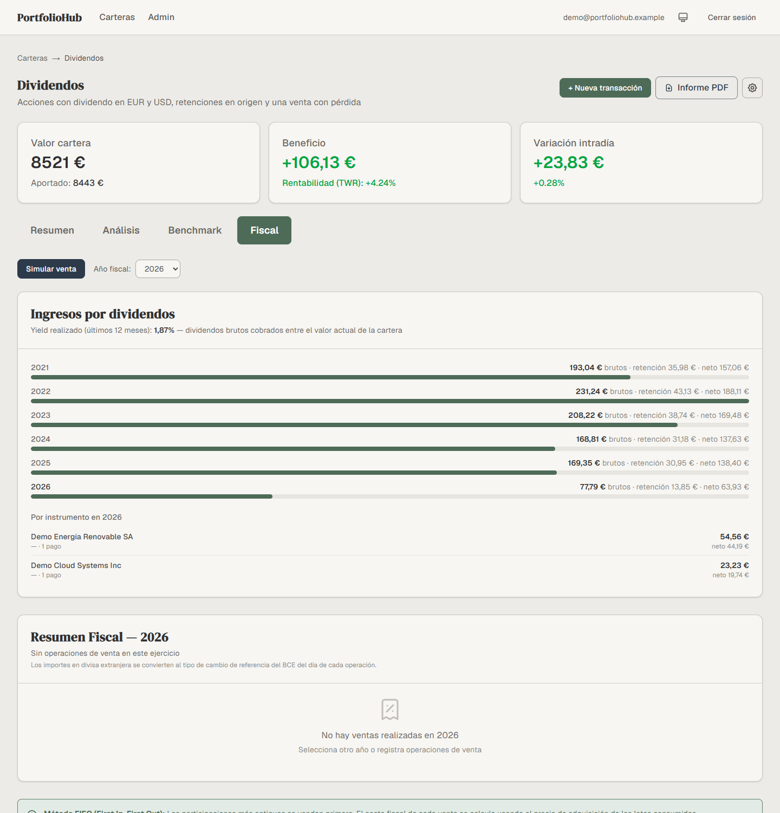
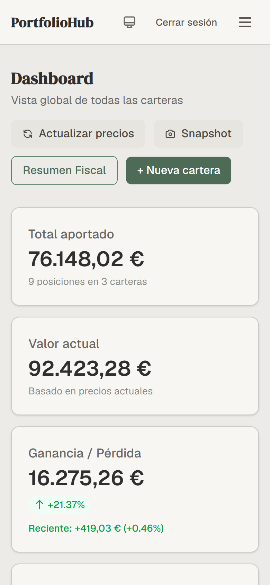
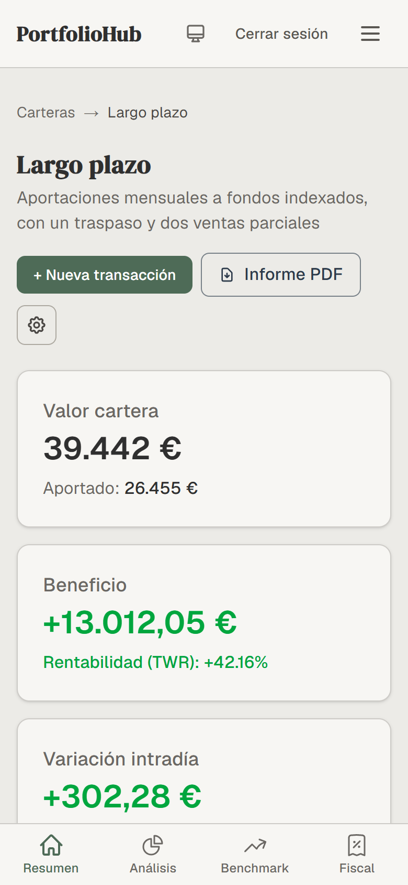

# portfoliohub-demo — the engines behind a family portfolio tracker

PortfolioHub is a web application that tracks investment portfolios (funds, ETFs, stocks) for a
family: positions and operations, daily prices and ECB exchange rates, time-weighted and
money-weighted returns, risk, dividend income, fund costs, look-through composition, and the Spanish
tax view (FIFO lots, the two-month rule, loss carry-forward, fund transfers that defer tax). It runs
in production on Vercel with a Neon Postgres database, built with Next.js 16, React 19, TypeScript,
Prisma 7 and Tailwind v4.

This repository holds the part of it that can be read on its own: the **pure TypeScript engines**
and their test suite. The application shell (pages, components, API routes, authentication, Prisma
schema and migrations, price providers, cron) stays private, and so does every piece of data.

> Public export of a private working repository. Every number in the screenshots comes from the
> synthetic dataset generator included here (`src/lib/synthetic`): the instruments, ISINs, people and
> operations are invented. No credential ever lived in the private repository's source either: the
> database URL, auth secret and cron secret are environment variables.

[](https://github.com/CasteSan/portfoliohub-demo/actions/workflows/tests.yml)




## What is in here

| Area | Files | What it does |
|---|---|---|
| Spanish tax engine | `src/lib/tax/` | FIFO lot matching per instrument with the two-month wash-sale rule, IRPF savings brackets, four-year loss carry-forward, fund transfers that drag the fiscal cost, every trade converted to EUR at the ECB rate of its date |
| Returns and risk | `metrics-utils`, `risk-utils`, `evolution-engine`, `correlation-utils` | Time-weighted return from real cash flows, XIRR, daily evolution replay with forward-filled prices and weekly downsampling, annualised volatility, 1.65σ "bad year" phrase capped at 100%, SRRI bucket, max drawdown, Sharpe, correlation of daily returns |
| Currencies | `fx-utils`, `ecb-provider`, `valuation-utils` | ECB reference rates (daily XML and SDMX CSV parsers with fixtures), pivot through EUR, forward-fill of up to 7 days, coverage report of what could not be converted, spot valuation in the portfolio currency |
| Income and costs | `income-utils`, `ter-utils`, `budget-utils`, `allocation-utils` | Dividends by year and instrument with withholding at source, weighted TER with coverage, time budget for provider calls, allocation slices |
| Broker import | `src/lib/import/` | Parsers for generic CSV, MyInvestor (an HTML file disguised as `.xls`) and Interactive Brokers activity statements, plus the choice of listing when an ISIN trades in several currencies |
| Provider layer | `src/lib/price-providers/registry.ts`, `fetch-retry.ts` | Routing of price requests by instrument type with fallbacks, retry with timeout. The providers themselves (Yahoo Finance, Morningstar) are private |
| Synthetic data | `src/lib/synthetic/dataset.ts` | Deterministic generator of users, portfolios, instruments, daily prices, FX rates, operations, positions and monthly snapshots from a seed, used for screenshots, demo databases and tests |

Everything is pure: no database, no framework, no network. The suite (`vitest`) runs in about a
second and the fiscal engine and `metrics-utils` are kept above 90% coverage in the private CI.

## Architecture (private application)

```
 browser (PWA, mobile first)           Next.js 16 on Vercel                        data
 ──────────────────────────           ───────────────────────────                 ─────────────
 server components + charts  ◄──────  app router pages and API routes             Neon Postgres
 (lightweight-charts, PDF)            │  auth (NextAuth, credentials, RBAC)       via Prisma 7
                                      │  ┌────────────────────────────────┐       ───────────────
                                      └─►│  pure engines  (this repo)     │◄───── ECB rates (XML/SDMX)
                                         │  tax · metrics · risk · fx ·   │◄───── Yahoo Finance
                                         │  evolution · import parsers    │◄───── Morningstar
                                         └────────────────────────────────┘
                                      daily cron: prices, FX, avgCostBase, snapshots
```

Two rules shaped the design. **Prices stay in their own currency and conversion is a read**: every
view converts at the ECB rate of the relevant date, so the fiscal report, the evolution chart, the
snapshots and the X-Ray agree with each other and declare what they could not convert. **Tests define
correctness**: the engines were extracted from the pages precisely so that they could be tested
without a database, and a behaviour is changed by changing its test first.

## How it grew

| Phase | What happened |
|---|---|
| Feb-Mar 2026 | First build: multi-client portfolios with roles, FIFO tax module, X-Ray report, Neon + Vercel, daily cron. 82 commits in eight weeks. |
| Jun 2026, audit | A code, data and UX audit produced the plan for the next five phases. |
| A, foundations | Test suite for the fiscal engine and metrics (251 tests, 98% coverage), squashed Prisma baseline, retry and timeout for the providers, staleness badge. |
| B, mobile | Tables to cards under `sm`, decimal keyboards, PWA with a service worker that never caches financial data, bottom navigation, pagination. |
| C, charts | The evolution engine moved server-side and characterised byte for byte against the old responses; `lightweight-charts` replaced most of Recharts; weekly downsampling cut the 5-year payload by 72%. |
| D, metrics for non-professionals | TWR next to MWR with plain-language copy, "contributed vs worth today", the "how much can it hurt" card (1.65σ, SRRI 1-7), one-tap sale simulator, dividend income and TTM yield, weighted TER, auto-loading X-Ray. |
| E, data coverage | Provider registry with routing (Yahoo, then Morningstar for funds), ECB FX layer from 2021 with `avgCostBase`, conversion as a read everywhere, fiscal report in EUR at the rate of each trade, import resolver that picks the listing of the CSV currency. 529 tests. |
| Oct 2026 | Corporate action handling (a 1:25 reverse split applied idempotently), the risk phrase capped at 100% with the rounding band tested, and this public copy with the synthetic dataset. |





<p>


</p>

## Run the tests

Requirements: Node 20 or newer.

```bash
npm install
npx tsc --noEmit
npx vitest run
```

The synthetic dataset can be generated from any script or test:

```ts
import { generateSyntheticDataset } from "@/lib/synthetic/dataset";

const data = generateSyntheticDataset({ seed: 42, start: "2021-01-04", end: "2026-10-23" });
// data.instruments, data.prices, data.fxRates, data.transactions, data.positions, data.snapshots
```

The private repository writes it to a separate demo database with a small Prisma script and takes
the screenshots above from a second `next dev` instance pointed at it.

## Layout

```
src/lib/
├── tax/                  FIFO engine, IRPF calculator, loss carry-forward, FX of transactions
├── import/               parsers (generic, MyInvestor, Interactive Brokers), listing choice, types
├── price-providers/      registry (routing and fallbacks), fetch with retry, shared types
├── synthetic/            dataset generator and its tests
├── __fixtures__/         ECB daily XML and SDMX CSV samples
└── *.ts                  metrics, risk, evolution, fx, valuation, income, ter, budget, ...
vitest.config.ts          node environment, "@/" alias
```

## License

All rights reserved; published for portfolio and review. See [LICENSE](LICENSE).
